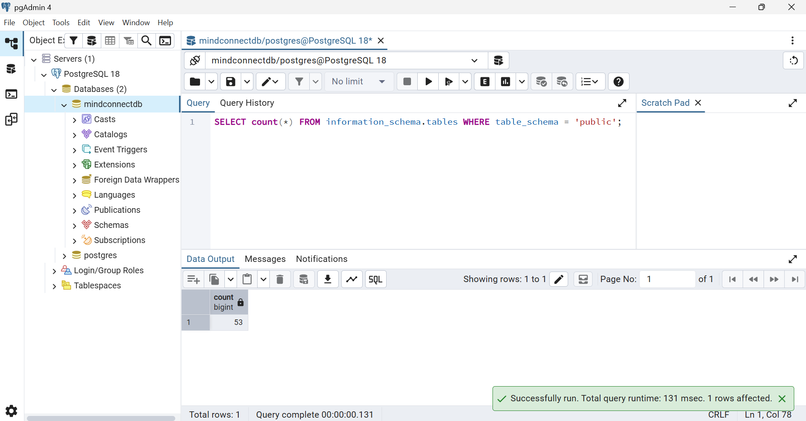
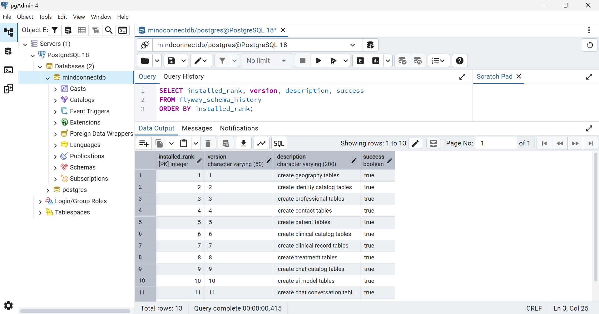

# MindConnect — Migración de base de datos con Flyway

Mini proyecto del skill de Spring Boot (Campuslands): creación del esquema de **52 tablas** de MindConnect en PostgreSQL mediante migraciones versionadas con **Flyway**, sobre un proyecto **Maven multimódulo con Arquitectura Hexagonal + DDD**.

## Stack

| Tecnología | Versión |
|---|---|
| Java | 25 |
| Spring Boot | 4.0.2 |
| Flyway | gestionado por Spring Boot (`spring-boot-starter-flyway`) |
| PostgreSQL | 13 o superior (usa `gen_random_uuid()` nativo) |

## Estructura del proyecto

```
mindconnect/
├── pom.xml                      ← padre (packaging pom, BOM de Spring Boot)
├── domain/                      ← núcleo: Java puro, sin Spring ni JPA
│   └── com.mindconnect.domain
│       ├── model/aggregates
│       ├── model/valueobject
│       ├── repositories         ← puertos (interfaces)
│       ├── exceptions
│       └── events
├── application/                 ← casos de uso, depende solo de domain
│   └── com.mindconnect.application
│       ├── config · dtos · exceptions · mappers · ports · usecases
└── infrastructure/              ← adaptadores + Spring + main
    ├── com.mindconnect.infrastructure
    │   ├── MindConnectApplication.java
    │   └── adapters
    │       ├── inbound  → controller · exceptionhandler · dtos
    │       └── outbound → persistence/entities · mappers · repositories
    └── src/main/resources
        ├── application.yml          ← común (activa perfil dev)
        ├── application-dev.yml      ← datasource, JPA, Flyway
        └── db/migration             ← V1 ... V13
```

Dirección de dependencias: `infrastructure → application → domain`. El dominio no conoce a nadie.

Cada paquete tiene un `package-info.java` que documenta su responsabilidad (además, Git no versiona carpetas vacías).

## Migraciones

Las migraciones están agrupadas por **contexto de negocio** y ordenadas por **dependencias**: ninguna tabla referencia a otra que todavía no exista.

| Versión | Contexto | Tablas | Acumulado |
|---|---|---|---|
| V1 | Geografía | countries, state_regions, city_municipalities | 3 |
| V2 | Catálogos de identidad | document_types, genders, relationship_types, professional_types, studies | 8 |
| V3 | Profesionales | professionals, professional_studies | 10 |
| V4 | Contactos | contacts, phone_contacts, email_contacts | 13 |
| V5 | Pacientes | patients, patient_contacts, patient_allergies | 16 |
| V6 | Catálogos clínicos | clinical_record_statuses, encounter_types, encounter_modalities, encounter_statuses, risk_levels, treatment_statuses, treatment_goal_statuses, medication_routes, assessment_types, consent_types, diagnostic_systems | 27 |
| V7 | Historia clínica | clinical_records, encounters, clinical_notes, mental_status_exams, risk_assessments | 32 |
| V8 | Tratamiento | treatment_plans, treatment_goals | 34 |
| V9 | Catálogos de chat | sender_types, priorities, conversations_statuses, message_types, ai_runs_statuses, escalations_statuses | 40 |
| V10 | Modelos de IA | provider_models_ai, ai_models | 42 |
| V11 | Conversaciones | chat_conversations, chat_participants, chat_messages, chat_conversation_ai_settings | 46 |
| V12 | Ejecuciones IA | chat_ai_runs, chat_ai_run_metrics, chat_ai_run_errors | 49 |
| V13 | Escalamientos | chat_escalations, chat_escalation_assignments, chat_escalation_status_history | **52** |

### Convenciones

- Archivos: `V<n>__<descripcion_en_snake_case>.sql` (dos guiones bajos).
- Llaves primarias `UUID` con `DEFAULT gen_random_uuid()`.
- Restricciones con nombre explícito: `pk_<tabla>`, `fk_<tabla>_<referencia>`, `uk_<tabla>_<columna>`, `ck_<tabla>_<regla>`, `idx_<tabla>_<columna>`.
- Índices en las columnas FK de navegación (PostgreSQL **no** indexa las FK automáticamente).
- `ON DELETE CASCADE` solo en tablas que son parte de su padre (teléfonos/correos de un contacto, métricas/errores de un run). El resto usa el comportamiento por defecto (impide borrar datos referenciados).
- Nulabilidad: `NOT NULL` por defecto; nulas las columnas marcadas `N` en el diagrama y las que por su ciclo de vida se llenan después (`ended_at`, `closed_at`, `signed_at`, `completed_at`, notas y observaciones).
- **Una migración aplicada nunca se modifica.** Cualquier cambio va en una nueva versión (`V14__...`). Por eso `validate-on-migrate: true`.

### Ajustes respecto al diagrama

| Diagrama | Migración | Motivo |
|---|---|---|
| `professionals.professional_type` | `professional_type_id` | Consistencia: todas las FK terminan en `_id` |
| `patients.gender_identity` | `gender_identity_id` | Igual que la anterior |
| `treatment_goals.treatment_goal_id` | `treatment_goal_status_id` | Apunta a `treatment_goal_statuses`; el nombre original confunde con el id de la meta |
| `phone_contacts.Column1`, `Column2` | `created_at`, `updated_at` | Columnas sin nombre ni tipo; se alinean con `email_contacts` |
| `provider_models_ai.isActive` | `is_active` | snake_case como el resto del esquema |
| `provider_models_ai.razon_social VARCHAR` | `VARCHAR(150)` | Longitud explícita |
| `clinical_record_statusses`, `encounter_statusses`, `treatment_statusses`, `treatment_goal_statusses` | `..._statuses` | Ortografía correcta en inglés y consistente con `conversations_statuses`, `escalations_statuses` y `ai_runs_statuses` del mismo diagrama |
| `ai_models.provider_model_id VARCHAR(50)` | `UUID` | Es FK a `provider_models_ai.id` (uuid): los tipos de la FK y la PK deben coincidir |
| `city_municipalities.code_citi` | `code_city` | Error de tipeo; consistente con `name_city` |
| `patients.city_id` (sin tipo) | `UUID` | FK a `city_municipalities.id` |
| `U` en `first_name` y `last_name` de professionals | `UNIQUE (document_type_id, document_number)` | Dos profesionales pueden llamarse igual; lo único es el documento por tipo |

Mejoras añadidas: unicidad del documento por tipo en `patients`, códigos únicos en catálogos geográficos y de chat, `CHECK` de fechas (fin ≥ inicio), precios y tokens no negativos, y un participante de chat que no puede ser paciente y profesional a la vez.

## Evidencias

### 1. Historial de migraciones registrado por Flyway

Flyway registra cada migración aplicada en la tabla `flyway_schema_history`. Las 13 versiones (V1 a V13) aparecen en orden y con `success = true`.

```sql
SELECT installed_rank, version, description, success
FROM flyway_schema_history
ORDER BY installed_rank;
```



### 2. Esquema creado: 53 tablas (52 del modelo + flyway_schema_history)

```sql
SELECT count(*) FROM information_schema.tables WHERE table_schema = 'public';
```



## Cómo ejecutarlo

1. Crear la base de datos en PostgreSQL:
   ```sql
   CREATE DATABASE mindconnectdb;
   ```
2. Ajustar credenciales en `application-dev.yml` o por variables de entorno (`DB_URL`, `DB_USERNAME`, `DB_PASSWORD`).
3. Compilar e instalar los módulos (desde la raíz):
   ```bash
   mvn clean install
   ```
4. Arrancar la aplicación (Flyway migra al iniciar):
   ```bash
   mvn -pl infrastructure spring-boot:run
   ```
   o desde VS Code: botón **Run** sobre `MindConnectApplication`.
5. Verificar:
   ```sql
   SELECT installed_rank, version, description, success
   FROM flyway_schema_history ORDER BY installed_rank;

   SELECT count(*) FROM information_schema.tables WHERE table_schema = 'public';
   -- 53 = 52 tablas + flyway_schema_history
   ```
